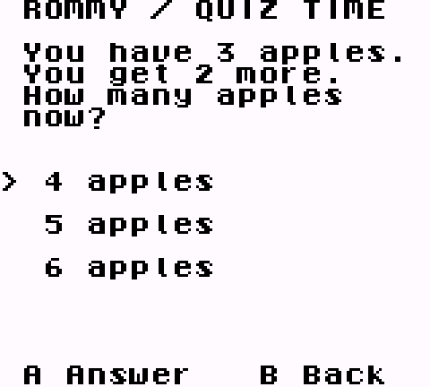

# Rommy for ModRetro developers

Add educational questions to a **Game Boy / Game Boy Color homebrew game targeting ModRetro Chromatic**. Open a question at a chest, level ending, or other checkpoint; let the player answer on the handheld; then return to your game. Answers stay in the cartridge save until a computer imports them into Rommy's learning progress.

**Source access:** this public repository contains the guide and reference documentation. The native source kit is currently access-controlled. [Contact Rommy](mailto:support@rommygames.com) to arrange access to the ModRetro integration kit. Build commands below apply to that source checkout; this documentation repository alone does not contain a buildable game.

**Start here:** [Try the demo](#try-the-demo) · [Connect real questions](#connect-real-questions-and-progress) · [Give this to your coding agent](#give-this-to-your-coding-agent)

> **Developer preview:** the native ROM and save/import flow have passed automated GB/GBC emulator and software tests. No physical Chromatic or cartridge has been qualified. This is a source-level homebrew integration; it does not add questions to arbitrary existing cartridges. ModRetro M64 is outside this adapter's supported platforms.



*Actual emulator capture using a synthetic demo question. This is not a photograph of a Chromatic.*

## How it fits into your game

| Where | What happens |
| --- | --- |
| Trusted computer or backend | Use your Rommy project API key to create a lesson and compile its question pack into the ROM. |
| Homebrew game | Call the native quiz module at your chosen checkpoint. It displays text and choices, gives feedback, and records answers in persistent save memory. Gameplay and questions work offline. |
| Trusted computer, after play | Export the cartridge's battery save and import it into Rommy. Confirmed imports update the learner's progress; repeating the same import does not count it twice. |

The implementation uses the `integrations/chromatic` directory in the Rommy source checkout. See the [build reference](docs/BUILD.md) for its file layout and integration details.

**An ordinary Rommy project API key is sufficient for this flow. Coinbase and x402 setup are not required.** The key stays on your computer or backend; never put it in a ROM, save file, public browser bundle, or agent prompt.

## Try the demo

Once you have the source kit, you can run its synthetic demo in an emulator without a Rommy API key or a physical handheld.

1. Install Node.js 22 or later.
2. Download and extract the official [GBDK 4.5.0 release](https://github.com/gbdk-2020/gbdk-2020/releases/tag/4.5.0) for your operating system. Follow the [toolchain verification notes](docs/BUILD.md#build-the-demonstration).
3. From the Rommy source checkout provided to you, build the sample:

```sh
cd /absolute/path/to/EduRoms
export GBDK_HOME="/absolute/path/to/gbdk"
bash integrations/chromatic/build.sh
```

Open `integrations/chromatic/build/rommy-quiz.gb` in a GB/GBC emulator with battery-save support. Press **A** to start, **Up/Down** to select, **A** to save an answer, or **B** to cancel before submission.

The demo contains three synthetic questions. It exercises the same native module your game can call, but its fixture assignment cannot be uploaded as real student progress. Keep its generated `assignment.json` with the ROM and battery save.

For repeatable emulator checks, screenshots, and interrupted-save tests, see [Simulation and validation](docs/SIMULATION.md).

## Connect real questions and progress

### 1. Create your Rommy project and key

Sign into the [API portal](https://rommygames.netlify.app/api-portal/onboarding), create a project, and check its [plan and usage limits](https://rommygames.netlify.app/developers/pricing). Real uploads require an ordinary project with an active or trial subscription. Wallet-funded x402 prepaid projects do not support these offline operations.

Create a project key with these permissions:

| Permission | Purpose |
| --- | --- |
| `offline:assignments:create` | Prepare a lesson for a learner. |
| `offline:assignments:read` | Retrieve the original lesson and its import position. |
| `offline:attempts:write` | Import saved answers. |
| `progress:read` | Optional: read that learner's progress through your backend. |

The ordinary `sessions:create` permission alone does not authorize cartridge operations. Use a stable, project-scoped `externalLearnerId` for each learner. This developer flow does not automatically pair with an existing Rommy family/student account; a consumer product needs its own authorized account/device pairing.

### 2. Prepare a lesson

On your trusted computer or backend, call:

```text
POST https://rommygames.netlify.app/api/public/v1/offline/assignments
Content-Type: application/json
X-Rommy-Api-Key: <read from protected server settings>
Idempotency-Key: <persist one unique key for this lesson request>
```

```json
{
  "externalLearnerId": "your-stable-learner-id",
  "questionIds": ["a-real-compatible-question-id"]
}
```

Select **1–32 real question IDs** from your Rommy content setup. If you need help finding a compatible selection, contact [Rommy support](mailto:support@rommygames.com). The demo's question IDs are fixtures. This version accepts bounded plain ASCII text with two to four choices; questions requiring diagrams, audio, or mathematical markup need an authored native equivalent. The server rejects incompatible content.

Save the successful response as `assignment.json` in a private workspace. Persist the request body and idempotency key before sending; after an uncertain response, retry those same values. Keep lesson responses and saves out of Git.

Build that assignment into the demo, using a separate output directory for each lesson:

```sh
bash integrations/chromatic/build.sh \
  /absolute/path/to/private/assignment.json \
  integrations/chromatic/build/lesson-one
```

### 3. Call the module from your own game

Use the [homebrew integration instructions](docs/BUILD.md#reuse-in-an-original-game) and `integrations/chromatic/native/demo.c` source file to compile the quiz, save implementation, and generated question pack into your game. At a checkpoint, after setting up the lesson's save and pausing your game timers/audio, the core call is:

```c
rommy_quiz_display_init();
uint8_t result = rommy_quiz_run(question_index);
/* Handle ROMMY_QUIZ_SAVED, ROMMY_QUIZ_CANCELLED or ROMMY_QUIZ_ERROR. */
/* Restore your game's screen/audio before resuming play. */
```

`ROMMY_QUIZ_SAVED` means the answer was saved locally, whether correct or incorrect. Cloud progress updates only after a successful computer import.

The reference build uses **ROM bank 1 and the entire 8 KiB SRAM bank 0**. Reserve those resources explicitly so the quiz cannot overlap your game's assets or save data. A custom storage layout needs the documented storage adapter. Save initialization requires a genuinely empty region and an explicit player action; never erase an existing game save to make the demo fit.

### 4. Import the battery save

Export the matching **8192-byte battery save** as `game.sav`. Use the original assignment and save together. Emulator save-states are a different format.

First inspect it locally, with no network request:

```sh
node integrations/chromatic/bin/import-save.cjs \
  /absolute/path/to/private/assignment.json game.sav --dry-run
```

For a real lesson, load `ROMMY_API_KEY` from protected local settings, set the API origin, and import:

```sh
export ROMMY_API_BASE_URL=https://rommygames.netlify.app
node integrations/chromatic/bin/import-save.cjs \
  /absolute/path/to/private/assignment.json game.sav
```

The importer uses the REST API and leaves the save untouched. After a lost connection, preserve the files and rerun the same import. Previously committed answers replay safely. Conflicts or damaged saves need review; follow the [recovery instructions](docs/BUILD.md#create-a-lesson-and-sync-its-save) rather than replacing the assignment identity.

## Give this to your coding agent

Copy this prompt into your agent. Supply credentials through its protected environment, separately from the prompt.

```text
Integrate Rommy educational checkpoints into my GB/GBC homebrew game targeting
ModRetro Chromatic. Start at:
https://github.com/kylewalsh525/rommy-modretro

Read the linked build reference, hardware limits, and simulation instructions.
The native source kit requires access from Rommy. If it is unavailable, tell me
to request it from support@rommygames.com before attempting a build. Once the
kit is available, inspect its native demo. First build and run the synthetic demo in an emulator without
production credentials or student data. Then adapt the native quiz module to
my game's source and checkpoint events. Reserve its ROM/SRAM regions, handle
saved/cancelled/error results, and restore game graphics, audio, and timing.

For real lessons, use a Rommy project API key on a trusted backend/computer with
offline:assignments:create, offline:assignments:read, offline:attempts:write,
and progress:read when needed. Use https://rommygames.netlify.app as the REST
origin. Obtain compatible real question IDs; do not invent IDs or upload demo
fixtures. Persist lesson request bodies and idempotency keys. Keep each original
assignment, ROM and battery save together; preserve identity when retrying imports.
Keep API keys and personal student details out of ROMs, saves, Git and prompts.

Test answer persistence, reboot, cancellation, full/damaged saves and duplicate
imports in simulation. Report any game-engine adaptation still needed and any
physical cartridge/save-export requirements not yet validated. Do not flash or
erase hardware, change billing, or enable wallet payments as part of this setup.
```

## Before putting it on hardware

The reference ROM needs an MBC5-compatible cartridge with at least **8 KiB persistent save memory**, plus a working battery-save export method. No specific cartridge has been qualified by this project. Follow [hardware support and qualification](docs/HARDWARE.md) for the exact console, cartridge, flashing, save-export, and applicable developer-tool requirements.

Each lesson holds at most **32 questions**; the save journal holds **338 answer records** and stops when full. Import and archive that lesson before deliberately preparing a new one. Correct answers are present in the ROM for offline feedback, so this is a practice-learning integration.

The integration kit is a native GBDK source module. A GB Studio plugin, M64 adapter, automatic cartridge patcher, and consumer device-pairing service are not included. For same-screen quizzes on Linux emulators, use the separate [RetroArch / RetroPie bridge](https://rommygames.netlify.app/developers/docs/retro-integrations).

## Further reading

- [Native module, build and importer reference](docs/BUILD.md)
- [Save format and API contract](docs/PROTOCOL.md)
- [Simulation evidence and reproduction](docs/SIMULATION.md)
- [Hardware qualification](docs/HARDWARE.md)
- [Rommy developer getting started](https://rommygames.netlify.app/developers/docs/getting-started)
- [Hosted retro integration guide](https://rommygames.netlify.app/developers/docs/retro-integrations)

This integration is maintained by Rommy; it is not an official ModRetro product or a hardware certification.
